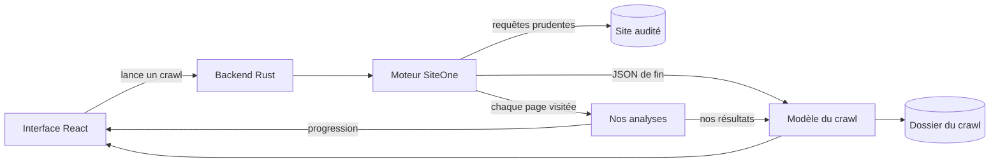

# Arpenteur : un crawler SEO desktop bâti sur le moteur SiteOne

Conception, version 2 · 20 novembre 2026 · statut : relue, à valider · « Arpenteur » est un nom de travail

## 1. Le problème

Pour auditer le SEO technique d'un site, l'outil de référence est Screaming Frog. Il est propriétaire, et payant au-delà de 500 URL. Je veux mon propre outil : générique (sans marque, Crocweb n'en est qu'un utilisateur), d'abord pour moi, et partageable avec une personne qui travaille sous Windows et sous Mac.

Le moteur existe déjà. SiteOne Crawler (Rust, licence MIT, version 2.5.1 de juin 2026, maintenu) crawle vite et proprement, et analyse déjà beaucoup de choses. Deux manques :

- son interface officielle est à l'abandon : elle date de 2024, embarque l'ancien moteur PHP et n'est pas notarisée, donc macOS la bloque ;
- des contrôles SEO importants manquent ou ne marchent pas. Test du 20 novembre sur crocweb.fr : il n'a pas vu que les canonicals pointent vers une URL qui redirige, et son extraction personnalisée renvoie vide sur les attributs (il convertit le XPath en sélecteur CSS par simple réécriture de texte, `[@rel="canonical"]` devient un sélecteur invalide).

## 2. Ce qu'on veut obtenir

- Je saisis une URL, je lance, je vois la progression. Pour un site de quelques centaines de pages, le résultat arrive en quelques minutes, à débit prudent.
- Un tableau de toutes les URL (statut, type, title, H1, indexabilité, profondeur, liens entrants), triable et filtrable.
- Une liste des problèmes classés par priorité, chacun avec son explication, la correction à faire et les URL concernées. C'est le cœur de l'outil.
- L'export CSV du tableau et des problèmes.
- Chaque crawl est conservé sur le disque, rangé par site.
- L'app tourne sur macOS (Apple Silicon) et Windows.

**Hors périmètre de la v1** : rendu JavaScript, comparaison entre deux crawls, intégrations (Search Console, GA4, PageSpeed), rapport client en marque blanche, sites de plus de 10 000 URL, Linux, mise à jour automatique.

**Ce qui ferait de l'outil un échec, même s'il marche** :

- faire bloquer l'IP de l'utilisateur ou ralentir le site audité ;
- signaler des problèmes qui n'en sont pas. Un faux positif coûte plus de confiance qu'un contrôle manquant.

## 3. Les choix structurants

### D1. Le moteur est SiteOne, intégré comme bibliothèque Rust

La crate `siteone-crawler` expose une bibliothèque (`siteone_crawler`) en plus de l'exécutable. L'app lance un crawl avec `Initiator` puis `Manager::run()`, exactement comme le fait le `main.rs` de la CLI.

La version est figée (`=2.5.1`), et on n'en change qu'après avoir rejoué le site de référence. La fonctionnalité `browser` (rendu JavaScript par Chromium) est désactivée, puisqu'il n'y a pas de rendu JS en v1. ⚠️ À vérifier : que la crate compile sans cette fonctionnalité.

Écartés :
- embarquer l'exécutable CLI : on ne lirait que son JSON final, sans pouvoir brancher nos contrôles ni suivre la progression ;
- écrire notre propre moteur : des mois pour refaire robots.txt, la limitation de débit, les redirections et toutes les analyses que SiteOne fait déjà bien.

### D2. Nos contrôles se branchent comme des analyses SiteOne, sans fork

`AnalysisManager::register_analyzer()` accepte toute analyse qui implémente le trait `Analyzer`. Sa méthode `analyze_visited_url` reçoit, pour chaque page visitée, l'URL, le corps et les en-têtes. Nos analyses y lisent le HTML et accumulent leurs résultats dans un état partagé avec le reste de l'app.

Vérifié dans le code de la 2.5.1 le 20 novembre : `analyze_visited_url` reçoit `body_text`, le corps brut de la réponse HTTP. Les retouches de SiteOne ne s'appliquent qu'à une copie qui sert à extraire les liens et à remplir ses colonnes personnalisées, ce qui explique l'échec de ses regex. Le test du jalon 0 le confirmera à l'exécution.

`Initiator` ne laisse pas ajouter d'analyse à la sienne. L'app construit donc elle-même ses `CoreOptions` (avec `parse_argv`, public) et son `AnalysisManager`, en recopiant la liste des analyses intégrées de SiteOne. Cette copie est liée à la version figée, et se relit à chaque montée de version.

### D3. La progression passe par nos analyses

SiteOne n'offre ni callback ni flux d'événements. Comme `analyze_visited_url` est appelée à chaque page, notre analyse envoie à chaque appel un événement Tauri à l'interface : l'URL, son statut, le nombre d'URL traitées. Le nombre total n'est pas connu à l'avance, donc l'interface affiche ce qui est fait et le temps écoulé, sans pourcentage.

### D3 bis. Un crawl arrêté garde ce qui a été vu

SiteOne a bien un arrêt propre (il finit les requêtes en cours puis écrit son JSON), mais seul un vrai Ctrl+C le déclenche, ce qu'une app graphique ne peut pas envoyer sous Windows. Le bouton « Arrêter » interrompt donc la tâche asynchrone, et SiteOne ne produit alors rien : ni JSON, ni analyses de fin.

Pour ne pas tout perdre, nos analyses relèvent elles-mêmes, au fil du crawl, tout ce qu'affiche le tableau : statut, type, title, meta description, H1, canonical, indexabilité, liens. Un crawl arrêté garde ainsi son tableau et nos problèmes. Les problèmes et les notes propres à SiteOne manquent, et l'app l'indique clairement. On ne forkera SiteOne pour exposer son arrêt propre que si ce manque gêne à l'usage.

### D3 ter. Un site qui limite les requêtes arrête le crawl

SiteOne ne ralentit pas sur un 429 ou un 503 et ignore l'en-tête `Retry-After`. Un site qui se met à limiter ou à bloquer remplirait le rapport de fausses erreurs, tout en continuant d'être sollicité.

Nos analyses comptent donc les réponses 429 et 503, ainsi qu'une série soudaine de 403 après des pages en 200. Au-delà d'un seuil (5 d'affilée par défaut, modifiable), l'app arrête le crawl comme en D3 bis et le marque « interrompu : le site limite les requêtes », en conseillant de baisser le débit. Le ralentissement automatique est écarté : SiteOne ne permet pas de modifier son débit en cours de route.

### D4. Les résultats sont fusionnés dans un modèle de crawl unique

À la fin du crawl, SiteOne écrit son JSON (la liste des URL, 27 tables d'analyse, les notes par catégorie). Nos analyses ont leurs propres résultats. L'app fusionne les deux dans un modèle unique : une ligne par URL, et une liste de problèmes. L'interface ne lit que ce modèle, jamais le JSON de SiteOne directement. Une montée de version de SiteOne ne touche donc que la fusion.

### D5. Le catalogue des problèmes nous appartient

Chaque problème a un identifiant stable, une priorité (haute, moyenne, basse), un titre, une explication et une correction, en français. Il est alimenté soit par une table SiteOne (404, titles dupliqués, en-têtes de sécurité…), soit par nos analyses.

Un quatrième niveau, **information**, regroupe ce qui est souvent voulu : un canonical vers une autre URL, une page en noindex, une page absente du sitemap, un contenu court. Ces constats apparaissent dans le tableau et le détail de l'URL, mais pas dans le décompte des problèmes.

Seuils de départ (modifiables, à valider au jalon 3) :

| Contrôle | Seuil |
|---|---|
| Title | moins de 30 ou plus de 60 caractères |
| Meta description | moins de 70 ou plus de 160 caractères |
| Image trop lourde | plus de 200 Ko |
| Contenu court (information) | moins de 200 mots |
| Pages en double | texte visible strictement identique (les quasi-doublons attendront) |

Règle contre les faux positifs : un problème détecté par nos analyses n'entre au catalogue qu'avec un test sur une page qui le présente et un test sur une page qui ne le présente pas. Les problèmes repris de SiteOne sont couverts par un site témoin local qui contient chaque cas, rejoué avant chaque montée de version.

Le jalon 3 démarre par un catalogue brouillon (liste, priorités, seuils, textes) que je valide avant d'écrire le panneau.

### D6. Une interface React + TypeScript (Vite), dans Tauri 2

C'est ma stack web, et Tauri sert une app web statique : Next.js n'apporterait rien sans serveur.

Écartés : SwiftUI (Mac seulement, alors qu'il faut Windows) et Electron (plus lourd, Node au lieu du Rust).

### D7. Un dossier par crawl, des fichiers JSON

Les crawls sont rangés dans le dossier de données de l'app : `sites/<domaine>/<date-heure>/`. Chaque dossier contient les réglages et le résumé du crawl, le JSON de SiteOne, nos résultats, et en bonus le rapport HTML de SiteOne.

Pas de base de données en v1 : des fichiers lisibles suffisent sous 10 000 URL. On passera à SQLite si la comparaison de crawls le demande.

### D8. Des réglages prudents par défaut, tous modifiables

Par défaut : 1 connexion, 2 requêtes par seconde, robots.txt respecté, 10 000 requêtes au plus, User-Agent `Arpenteur/<version>`. Chaque réglage se change dans l'app, par crawl ou par défaut.

La limite compte des requêtes, pas des pages : SiteOne compte chaque ressource téléchargée. Pour garder un crawl rapide à 2 requêtes par seconde, la v1 ne télécharge que les pages HTML et les images (pour leur poids). Le JavaScript, le CSS, les polices et les fichiers ne sont pas téléchargés. Ils sont exclus par filtre d'URL, et pas par les options `--disable-*` de SiteOne, qui retouchent le HTML et pourraient effacer le JSON-LD. ⚠️ À vérifier au jalon 0. La file d'attente de SiteOne (9 000 URL par défaut) est relevée au niveau de la limite. Les tables de cache et de performance de SiteOne seront moins complètes, ce qui est acceptable : elles sont en priorité basse.

### D9. Build Mac en local, build Windows sur GitHub Actions, sans signature payante en v1

Pour deux utilisateurs, pas de compte Apple Developer (99 USD par an) ni de certificat Windows. Conséquence : au premier lancement, chaque personne autorise l'app à la main. Sur Mac, Réglages Système > Confidentialité et sécurité > « Ouvrir quand même ». Sur Windows, SmartScreen > « Informations complémentaires » > « Exécuter quand même ». Le README contient cette notice.

Le dépôt est privé sur GitHub. Le build Windows tourne sur GitHub Actions, le build Mac se fait en local. Les installeurs sont partagés par les releases du dépôt, ou envoyés directement.

⚠️ À vérifier au jalon 5 : sur Apple Silicon, une app doit porter au moins une signature ad hoc pour démarrer (Tauri la pose), et le message exact affiché chez l'autre personne.

### D10. Une interface en français, avec les textes regroupés

Tous les textes de l'interface et du catalogue de problèmes sont dans un seul endroit, pour pouvoir ajouter l'anglais plus tard sans reprise.

## 4. Vue d'ensemble

Le moteur SiteOne fait le crawl, nos analyses s'y branchent, et l'app fusionne les deux résultats.



## 5. Les écrans

**Accueil** : la liste des sites déjà crawlés, avec pour chacun ses crawls datés, et le champ pour lancer un nouveau crawl.

**Crawl** (écran principal) :

```
┌ Arpenteur ─────────────────────────────────────────────────────┐
│ [ https://exemple.fr              ] [Lancer] [Arrêter]  Réglages │
│ 142 URL traitées · 1 min 12 s                                  │
├────────────────┬───────────────────────────────────────────────┤
│ Problèmes      │ URL              Statut  Title       H1   Prof. │
│ ● Haute (3)    │ /                200     Accueil…    oui  0     │
│   404 (2)      │ /tarifs          200     Tarifs…     oui  1     │
│   Canonical →  │ /ancienne-page   404     -           -    2     │
│   redirection  │ …                                              │
│ ● Moyenne (5)  ├───────────────────────────────────────────────┤
│ ● Basse (8)    │ Détail de l'URL : liens entrants et sortants,  │
│                │ en-têtes, problèmes de cette page              │
└────────────────┴───────────────────────────────────────────────┘
```

Un clic sur un problème filtre le tableau sur les URL concernées. Un clic sur une URL ouvre son détail en bas.

**Réglages** : débit, nombre de connexions, User-Agent, robots.txt, limite d'URL, inclusions et exclusions par regex.

## 6. Les contrôles de la v1

| Contrôle | Fait par |
|---|---|
| Codes HTTP, 4xx, 5xx, erreurs réseau | SiteOne |
| Redirections ; chaînes de redirections, redirection temporaire (302, 307) sur une URL interne | SiteOne ; nous |
| Title et meta description : absents, trop longs ou trop courts, dupliqués | SiteOne |
| H1 absent ou multiple, structure des titres | SiteOne |
| Indexabilité : noindex, page bloquée par robots.txt | SiteOne ⚠️ vérifier la prise en compte de l'en-tête X-Robots-Tag |
| Canonical : absent, vers une autre URL, vers une URL qui redirige ou en erreur, vers un autre hôte | nous |
| Images : alt absent | SiteOne |
| Images trop lourdes | nous, à partir des tailles relevées par SiteOne |
| Données structurées : JSON-LD présent, JSON lisible, types déclarés (pas de validation schema.org en v1) | nous |
| Liens internes : liens entrants par page, ancres, liens cassés avec toutes leurs pages sources, profondeur de clic | nous |
| Sitemap : pages du sitemap absentes du crawl (orphelines), pages crawlées absentes du sitemap, URL du sitemap en erreur ou non indexables | nous |
| Contenu : nombre de mots, pages au texte identique | nous |
| Sécurité, cache, performances | SiteOne, en priorité basse |

**Le sitemap.** Avant le crawl, l'app lit `robots.txt` et le sitemap qu'il déclare, ou `sitemap.xml` à défaut (index de sitemaps compris). Ces quelques requêtes passent l'une après l'autre, avant que SiteOne démarre, donc sans dépasser le débit réglé. Les URL du sitemap sont ajoutées à la liste de départ de SiteOne : elles sont crawlées, figurent dans le tableau et comptent dans la limite. Est **orpheline** une URL du sitemap vers laquelle aucune page crawlée ne pointe. Une page crawlée mais absente du sitemap relève du niveau information.

**Le niveau information** (D5) concerne, dans ce tableau : un canonical vers une autre URL, le noindex, une page absente du sitemap et un contenu court.

## 7. Risques et points à vérifier

- **L'API de la bibliothèque n'est pas présentée comme stable.** Elle sert d'abord à la CLI. Parade : version figée, fusion isolée (D4), un site de référence rejoué avant chaque montée de version.
- **Le corps HTML reçu par nos analyses** (D2) : à vérifier en premier, au jalon 0.
- **La compilation Windows de la crate** : SiteOne publie des binaires Windows, donc elle compile, mais à vérifier dans notre configuration, au jalon 0 en CI.
- **L'arrêt d'un crawl en cours** (D3 bis) : à vérifier que l'interruption ne laisse ni l'app bloquée ni un dossier de crawl incohérent.
- **Un site qui limite ou bloque** : couvert par D3 ter, seuil à ajuster à l'usage.
- **La mémoire** : SiteOne garde le crawl en mémoire (sa propre aide dit que la limite d'URL « affecte la mémoire »). Sans risque sous 10 000 URL.
- **Les faux positifs** : couverts par la règle de D5.
- **La licence MIT** impose de garder la notice de SiteOne : elle figure dans l'écran « À propos ».

## 8. Découpage en jalons

0. **Test jetable.** Un petit programme Rust crawle crocweb.fr avec la bibliothèque, une analyse branchée affiche le corps reçu, l'exclusion du JS et du CSS par filtre d'URL est essayée, et un premier build tourne sous Windows en CI. Ce jalon tranche D2 (et son éventuel plan B) et D8.
1. **Coquille Tauri.** Saisie de l'URL, lancement, progression, arrêt, tableau brut des URL, enregistrement du crawl.
2. **Nos analyses.** Canonical, liens et profondeur, JSON-LD, sitemap, contenu.
3. **Catalogue et panneau Problèmes.** Priorités, filtres, détail d'une URL.
4. **Usage au quotidien.** Export CSV, historique des crawls par site, réglages.
5. **Distribution.** Build Windows en CI, installeurs Mac et Windows, notice d'installation, essai chez l'autre personne.

## 9. Questions ouvertes

- Le nom définitif (« Arpenteur » est un nom de travail).
- Le rapport client en marque blanche : placé en v2 (mon choix, à confirmer).
- La signature payante, si l'outil s'ouvre à plus de monde.
